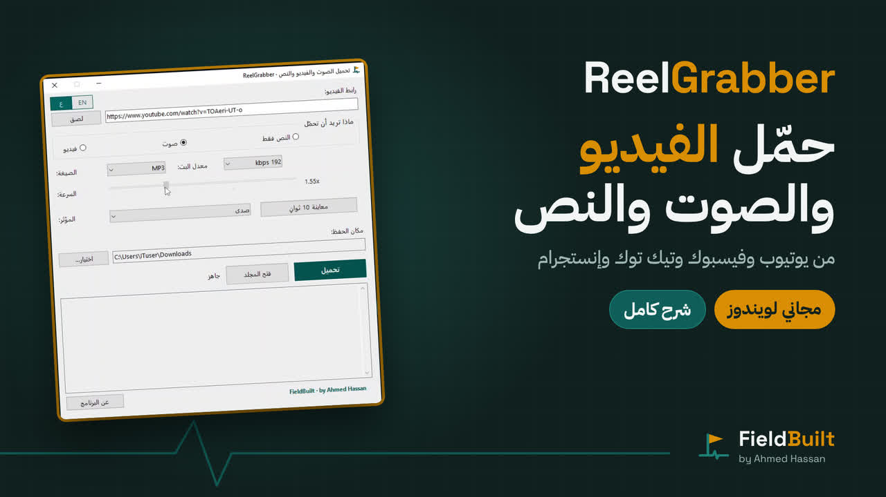
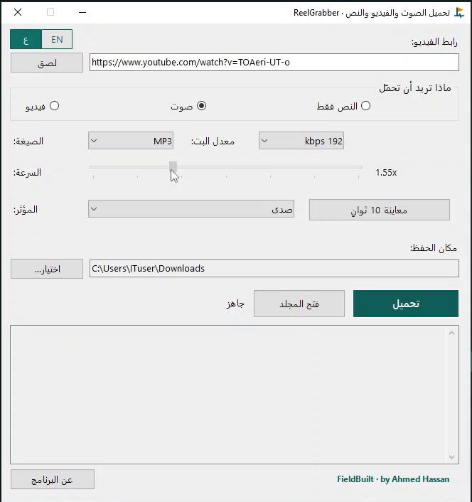

<h1 align="center">ReelGrabber</h1>

<b>Video, audio and transcripts from YouTube, Facebook, TikTok, Instagram and more.</b> 
A free Windows tool from <b>FieldBuilt</b> · <i>Field-tested. Research-backed.</i>

<a href="../../releases/latest"><b>⬇ Download the latest version</b></a>

---

## بالعربي

**ReelGrabber** أول أداة من **FieldBuilt**: برنامج صغير ومجاني لويندوز، بيحمّل الفيديو أو الصوت أو النص من يوتيوب وفيسبوك وتيك توك وإنستجرام ومواقع تانية كتير.

### بيعمل إيه
- **فيديو** بالجودة اللي تختارها: أفضل جودة، أو 1080p، أو 720p، أو 480p.
- **صوت** بصيغ MP3 و M4A و WAV و FLAC و OPUS.
- **السرعة** من 0.5x لـ 2x من غير ما نبرة الصوت تتغير. مفيدة للمحاضرات وتعلم اللغات.
- **12 مؤثر صوتي:** إزالة الضوضاء، ووضوح الكلام، وحذف السكوت، وصدى، وصوت راديو، وغيرهم.
- **معاينة 10 ثواني** قبل ما تنزّل الملف كله.
- **النص فقط:** لو الفيديو عليه ترجمة، بتنزل في ملف Word منسق بهوية FieldBuilt.
- **إضافة لكروم وفايرفوكس:** كليك يمين على أي فيديو، والبرنامج يفتح والرابط جاهز فيه.
- **الواجهة** عربي وإنجليزي بضغطة زرار.

### التثبيت
1. نزّل ملف ‎`ReelGrabber-v*.zip`‎ من صفحة [التحميل](../../releases/latest).
2. فك الضغط في فولدر اسمه إنجليزي، زي ‎`C:\ReelGrabber`‎.
3. شغّل **Install.bat**، وهو بيجهّز كل حاجة لوحده ويعمل اختصار على سطح المكتب.
4. لو ظهرتلك رسالة حماية من ويندوز، اختار **More info** وبعدين **Run anyway**.

### إضافة المتصفح (اختياري)
- **كروم أو إيدج:** افتح ‎`chrome://extensions`‎، وشغّل **Developer mode**، واختار **Load unpacked**، وبعدين فولدر ‎`extension`‎.
- **فايرفوكس:** افتح ‎`about:debugging`‎، وادخل على **This Firefox**، واختار **Load Temporary Add-on**، وبعدين ملف ‎`extension/manifest.json`‎.

### الإزالة
شغّل **Uninstall.bat**، وبعدين امسح الفولدر.

---

## English

**ReelGrabber** is the first tool from **FieldBuilt**: a small, free Windows app that saves video, audio or transcripts from YouTube, Facebook, TikTok, Instagram and many other sites.

- **Video:** best quality, 1080p, 720p or 480p.
- **Audio:** MP3, M4A, WAV, FLAC or OPUS.
- **Speed:** 0.5x–2x without changing the voice.
- **12 audio effects**, such as noise removal and voice clarity, with a 10-second preview.
- **Transcript only:** the video's captions saved as a clean, FieldBuilt-branded Word file.
- **Browser extension:** right-click any video in Chrome, Edge or Firefox to send it to the app.
- **Interface:** Arabic and English.

### Install
1. Download `ReelGrabber-v*.zip` from the [download page](../../releases/latest).
2. Extract it to a simple folder, for example `C:\ReelGrabber`.
3. Run **Install.bat**. It sets everything up and adds a desktop shortcut.

Works on Windows 10 and 11.

## Fair use

Download only content you own or are allowed to save. Respect creators and each platform's terms.

## Contact

**FieldBuilt** · Ahmed Hassan · ahassanccna@gmail.com · [LinkedIn](https://www.linkedin.com/in/ahmedhassan30/)

Free and open source under the GPL-3.0 license. Powered by the open-source projects yt-dlp and FFmpeg. © 2026 Ahmed Hassan (FieldBuilt).
